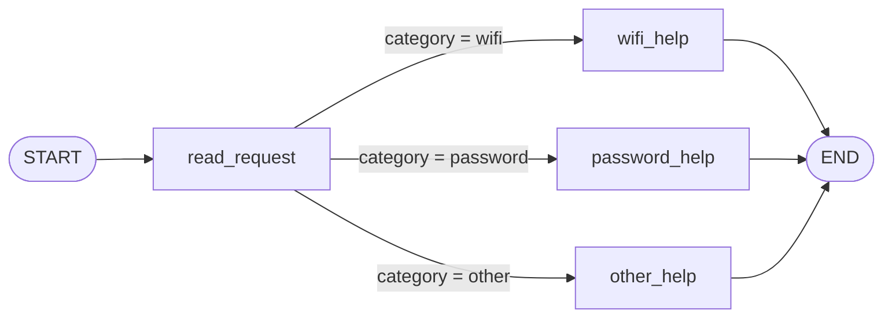
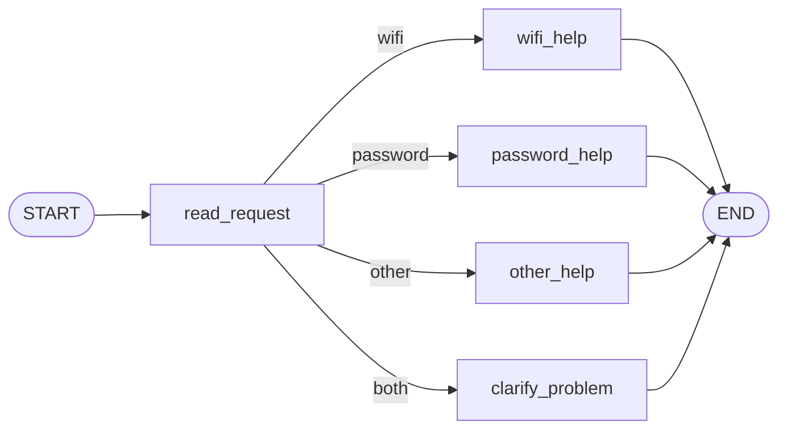
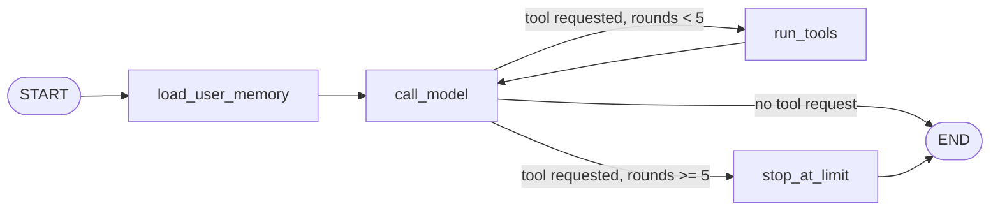

# HW5 — My LangGraph helpdesk

Python 3.13, langgraph 1.2.20. All results below come from my own runs (logs in `outputs/`).

## Part 1 — How the graph works

### My graph and state



State (`HelpdeskState`): `message` (user's text, never changed), `category` (set by `read_request`), `reply` (set by a help node).

1. **What each node reads and changes.**
   - `read_request` reads `message`, sets `category`.
   - `wifi_help` / `password_help` read nothing important and set `reply` from `data/helpdesk.json`.
   - `other_help` sets `reply` to the question "Wi-Fi or password?".
   - The routing function `choose_next` reads `category` and changes nothing.
2. **Node update vs. conditional edge.** A node returns a *partial update* of the state (a dict that LangGraph merges into the state). A conditional edge is a function that only returns the *name of the next node*; it changes no state.
3. **What the next node receives.** The *current full graph state* (original message + all updates merged so far), not only the previous node's update. For example, `wifi_help` can still read `message` and `category`.
4. **START, END, compile.** `START` and `END` are special markers for where execution enters and leaves the graph. `compile()` checks that the graph is valid (nodes and edges exist, a path to END) and turns the description into a runnable object (`invoke` / `stream`). Before compiling, it is only a blueprint.

### Predictions before running

*The predicted routes below were derived from the routing rules in the brief. I had already run the code once before writing them down.*

| Message | Predicted route | Actual route | What I learned |
| --- | --- | --- | --- |
| I cannot connect to Wi-Fi. | read_request → wifi_help | read_request → wifi_help | `wifi` matched, category = wifi |
| I forgot my PASSWORD. | read_request → password_help | read_request → password_help | matching ignores upper/lower case |
| My laptop screen is broken. | read_request → other_help | read_request → other_help | no keyword, so the fallback asks which problem |
| My Wi-Fi password does not work. | read_request → wifi_help | read_request → wifi_help | both topics present; the Wi-Fi rule is checked first, so password is ignored |

(Actual routes are from my run saved in `outputs/part1_original.json`.)

**Both topics.** "My Wi-Fi password does not work." contains `wi-fi` and `password`. The first rule (`wifi` → `wifi_help`) matches, so rule order decides: the password part is silently ignored, and the user gets Wi-Fi steps that may not be what they need.

### My change to the graph



`read_request` now sets `category = "both"` when both topics appear, and `choose_next` sends that to the new node `clarify_problem`.
New trace for "My Wi-Fi password does not work." (from `outputs/part1_with_clarification.json`):

```
read_request     update={'category': 'both'}
clarify_problem  update={'reply': 'Is the problem connecting to Wi-Fi, or recovering your account password? Which one do you want to solve first?'}
Route: START -> read_request -> clarify_problem -> END
```

The difference is in the *route* (a different node runs), not only in the final sentence.

### What LangGraph controls vs. what my Python decides

- **LangGraph controls:** running nodes in order, passing the current state to each node, merging each node's returned update into the state, following the edge chosen by the conditional edge, stopping at END, and reporting each step for the trace.
- **My functions decide:** how a message is classified (`classify`: keywords, case, rule order), which node name `choose_next` returns, and the text of every reply. No model makes any decision in Part 1.

## Part 2 — Model and tools

**Model and provider:** `gpt-4o-mini` from OpenAI, via `langchain-openai` (logs say `openai:gpt-4o-mini`).
Tests and CI use a labelled fake model (`helpdesk/fake_model.py`, keyword rules, not a language model). Its logs are in `outputs/fake-model/`; the real-model logs are in `outputs/real-model/`.

### Tools (`helpdesk/tools.py`)

| Tool | What it does |
| --- | --- |
| `find_instructions(topic)` | returns steps and id from `data/helpdesk.json` |
| `check_service_status(service, profile)` | returns operational / outage / unknown from one snapshot of `data/service_status.json`; the *program* supplies the profile |
| `prepare_ticket(...)` | saves a local JSON draft to `outputs/tickets/`; refuses if the problem or the steps tried are missing |
| `remember_preference` (Part 3) | writes the reply language to user memory |

Each tool works when called directly, without the agent:

```
>>> check_service_status('wifi','wifi_outage')
{'ok': True, 'service': 'wifi', 'status': 'outage', 'message': 'The demo Wi-Fi service is unavailable across campus. The fixture gives no repair time.', 'profile': 'wifi_outage', 'source': 'service_status.json'}
>>> find_instructions('wifi')
{'ok': True, 'topic': 'wifi', 'instruction_id': 'GUIDE-WIFI', 'title': 'Connect to the practice campus network', 'steps': ['Check that Wi-Fi is enabled and airplane mode is off.', 'Select the fictional Campus-Demo network.', 'If connection fails, forget the saved network and try connecting again.', 'If the problem remains, check the service status before preparing a ticket.'], 'source': 'helpdesk.json'}
```

`prepare_ticket` is tested directly in `tests/test_tools.py` (creates a draft file; refuses an empty problem and steps).

### The loop



**Loop limit.** `tool_rounds` is kept in the state and increased by `run_tools`. It is checked in the conditional edge `route_after_model`: if the model asks for another tool and `tool_rounds >= MAX_TOOL_ROUNDS` (5), the graph goes to `stop_at_limit`, which answers the pending requests with "not executed" and ends. `test_loop_limit_stops_runaway_model` uses a model that never stops. In all real runs the limit was not reached (logs say `Loop limit reached: False`).

1. **How does the graph decide between a tool and an answer?** `route_after_model` looks at the last model message: if it has `tool_calls`, go to `run_tools` (unless the limit is reached); otherwise END.
2. **Who requests and who executes?** The model only *requests* a tool (name and arguments in an AI message). My node `run_tools` executes it through `execute_tool`; the model never runs code. User id, thread id and the status snapshot are supplied by my program, not chosen by the model.
3. **What changes in the state after a tool result?** A `ToolMessage` with the result is appended to `messages`, and `tool_rounds` goes up by 1. Then `call_model` runs again with the result in view.
4. **How is this different from Part 1?** In Part 1 my fixed keyword rules choose the route. Here the model chooses *which tool is needed and whether another is needed*, depending on the tool results, so the path is not known in advance.

### Real run with several tools (S06) — `outputs/real-model/S06.txt`

Second message: "I enabled Wi-Fi and forgot the saved network, but Campus-Demo still will not connect. Check whether Wi-Fi is down. If it is operating, prepare a ticket about this problem."

```
call_model  -> requests check_service_status {"service": "wifi"}
run_tools   -> {"status": "operational", "profile": "normal", ...}          tool_rounds=1
call_model  -> requests prepare_ticket {"problem": "Campus-Demo Wi-Fi will not connect",
                 "steps_tried": ["Enabled Wi-Fi", "Forgot the saved network"], "category": "wifi",
                 "service_status": "operational", "reference_ids": ["GUIDE-WIFI"]}
run_tools   -> {"ok": true, "ticket_id": "TCK-270f390b", "file": "outputs/tickets/TCK-270f390b.json"}   tool_rounds=2
call_model  -> final answer: draft prepared, steps tried listed, "only a local draft, not sent"
```

The first message ("Show me the Wi-Fi troubleshooting steps.") used `find_instructions`. The ticket contains only the steps I stated, nothing invented. The ticket file is `outputs/tickets/TCK-270f390b.json`.

### The same request with different snapshots (S06 / S07 / S08)

| Snapshot | Status tool result | What the model did |
| --- | --- | --- |
| `normal` (S06) | `operational` | prepared the ticket (`TCK-270f390b`) |
| `wifi_outage` (S07) | `outage`, "no repair time" | no ticket; said Wi-Fi is down so it cannot prepare one |
| `status_unavailable` (S08) | `unknown` | no ticket; said it could not determine the status and asked whether I want a draft |

So the same conditional request led to different behaviour because the assistant used the tool result. `unknown` was treated as neither operational nor a confirmed outage.

Other Part 2 runs: S09 (missing details) — the first reply asked what the problem is and what I tried and made no tool call; after my details it prepared `TCK-040c14dc`. S14 — the model looked up `account_recovery` (not Wi-Fi), reported the outage, did not invent a repair time, and offered a draft.

## Part 3 — Memory

- **Conversation memory** = LangGraph state saved by a `SqliteSaver` checkpointer in `local-storage/checkpoints.sqlite`, per thread.
- **User memory** = a separate SQLite table in `local-storage/user_memory.sqlite`, per user (`helpdesk/memory.py`). The model saves it through `remember_preference`; `load_user_memory` loads it at the start of every turn.
- **`thread_id` vs. user id.** A `thread_id` identifies one *conversation* (its message history and progress). A user id identifies a *person*, whose preferences can span many conversations. My program supplies both; the model never chooses them. The checkpoint is saved under `user_id/thread_id`, so two users cannot read each other's thread even if they use the same thread name.
- **Retrieval vs. memory.** Looking up Wi-Fi instructions is *retrieval*: a fixed reference file that is the same for everyone and not changed by the conversation. Recalling that this user wants replies in Kazakh is *memory*: it was learned from this user, stored for them, and differs per user.

| Situation | Command used | Log file | What happened |
| --- | --- | --- | --- |
| Refer to an earlier message | `python -m helpdesk scenarios --id S10` | `outputs/real-model/S10.txt` | Asked "Which steps did I already try?" in the same thread. State had 6 messages; the model listed enabling Wi-Fi, forgetting the network and reconnecting. Source: conversation state only. |
| Close, restart and resume | `python -m helpdesk scenarios --id S11` | `outputs/real-model/S11.txt` | After a real process restart (same user and thread), the state had 5 messages and the user memory was read back. It recalled the Wi-Fi problem and the steps, in Kazakh. Sources: conversation state + user memory. |
| Same user, new conversation | `python -m helpdesk scenarios --id S12` | `outputs/real-model/S12.txt` | New thread `preference-a2`: 0 earlier messages (no replay), but user memory `reply_language = Kazakh` was loaded; it answered in Kazakh that I had asked for Kazakh. Source: user memory. |
| Different user | `python -m helpdesk scenarios --id S13` | `outputs/real-model/S13.txt` | `demo-user-b` had empty user memory and 0 messages; the reply said no preferred language or previous problem was shared. |

## Part 4 — Running and checking my work

- `README.md`: install, API key setup, run commands, scenario runner, where memory is stored (`local-storage/`) and how to reset it (`python -m helpdesk reset`).
- `requirements.txt`: exact versions I used (Python 3.13).
- Tests: `python -m pytest -q` → **28 passed**. What each file would catch:
  - `test_routing.py`, `test_part1_graph.py`: wrong Part 1 routing, case sensitivity, `clarify_problem` not reached.
  - `test_tools.py`: a tool ignoring the status snapshot, returning wrong instructions, or making a ticket without the problem or the steps tried.
  - `test_memory.py`: preferences lost after reopening the database, or visible to another user.
  - `test_agent.py`: ticket created despite outage/unknown, memory lost after restart, threads or users mixed, loop limit missing.
- **Fake model:** all tests and CI use `ScriptedFakeModel`. The real-model run (`outputs/real-model/`) is separate and was done by hand with `gpt-4o-mini`.
- **CI:** `.github/workflows/ci.yml` runs the tests on every push without an API key. The latest run on GitHub is green.
- **Commits:** Part 1 was committed on its own ("Part 1: fixed-route LangGraph helpdesk with clarification node"); Parts 2–4 were committed together ("Parts 2-4: tools, memory, tests, CI").
- Keys are in an ignored `.env`; memory databases are in the ignored `local-storage/`. The logs use only invented ids (`demo-user-a`, `demo-user-b`).

## Choices and limitations

- **Storage:** SQLite for both memories. It is local, needs no server, survives restarts, and `langgraph-checkpoint-sqlite` supplies the checkpointer. User preferences are in a separate small table so they do not depend on any one thread.
- **Libraries:** LangGraph (graph, checkpointer), `langchain-openai` (model adapter), pytest.
- **What still does not work reliably (seen in my real runs with `gpt-4o-mini`):**
  - The model sometimes calls tools nobody asked for. In S10 it checked Wi-Fi status although I only described a problem, and in S09 it checked status before preparing a ticket.
  - In S10 the first reply asked me again what I had tried, although I had already said it. The second reply, which used the conversation memory, was correct.
  - The "Information sources" line in my logs shows what was *read*, not what was *written*; so in S12 event 1 (saving the preference) it says `none`.
  - I did not verify the quality of the Kazakh replies; I only checked that they are in Kazakh and match the content.
  - Only `reply_language` can be remembered, and the conversation history is not trimmed, so very long threads would grow.
  - The fake model proves the graph and tools work but not that a real model behaves well.

## Supplied scenarios — my actual results

Part 1 scenarios (S01–S05) ran the Part 1 graphs without a model; S06–S14 ran with `openai:gpt-4o-mini`. All logs are in `outputs/real-model/` (the fake-model versions are in `outputs/fake-model/`).

| Scenario | Command or manual steps | Log file | What happened / what I changed |
| --- | --- | --- | --- |
| S01 — Simple Wi-Fi route | `python -m helpdesk scenarios --id S01` | `outputs/real-model/S01.txt` | `read_request → wifi_help`; category = wifi; Wi-Fi steps returned. Behaved as expected. |
| S02 — Case-insensitive password route | `--id S02` | `S02.txt` | `PASSWORD` in capitals still gave category = password → `password_help`. |
| S03 — Unsupported request | `--id S03` | `S03.txt` | No keyword → `other_help` asked "Wi-Fi or password?". |
| S04 — Two topics before the graph change | `--id S04` (original graph) | `S04.txt` | Category = wifi; Wi-Fi steps returned and the password part was ignored, because the Wi-Fi rule is first. This is the weakness I fixed in S05. |
| S05 — Two topics after adding clarification | `--id S05` (changed graph) | `S05.txt` | Category = both → new node `clarify_problem` asked which problem to solve first. |
| S06 — Instructions then local ticket | `--id S06` | `S06.txt` | `find_instructions`, then `check_service_status` (operational), then `prepare_ticket` → `TCK-270f390b`; steps came from my message. |
| S07 — Same request during a Wi-Fi outage | `--id S07` | `S07.txt` | Status = outage → no ticket, as I asked ("if it is operating"). |
| S08 — Status source unavailable | `--id S08` | `S08.txt` | Status = unknown → no ticket; asked whether to prepare a draft. |
| S09 — Missing ticket details | `--id S09` | `S09.txt` | First reply asked for problem and steps, no tool call. After my details → `TCK-040c14dc`. It also checked the status although I had not asked. |
| S10 — Use the current conversation | `--id S10` | `S10.txt` | Second turn listed my earlier steps from conversation state (6 messages). The first turn asked me again for steps I had already given. |
| S11 — Persist and recall after restart | `--id S11` | `S11.txt` | Real process restart; conversation (5 messages) and Kazakh preference recalled; replied in Kazakh. |
| S12 — Preference across threads without replay | `--id S12` | `S12.txt` | New thread had 0 messages but loaded `reply_language = Kazakh` from user memory; answered in Kazakh. |
| S13 — Do not share memory between users | `--id S13` | `S13.txt` | `demo-user-b` saw empty memory and 0 messages; nothing from `demo-user-a` appeared. |
| S14 — Password recovery outage | `--id S14` | `S14.txt` | Looked up `account_recovery` → outage; no repair time invented; offered a draft. |
